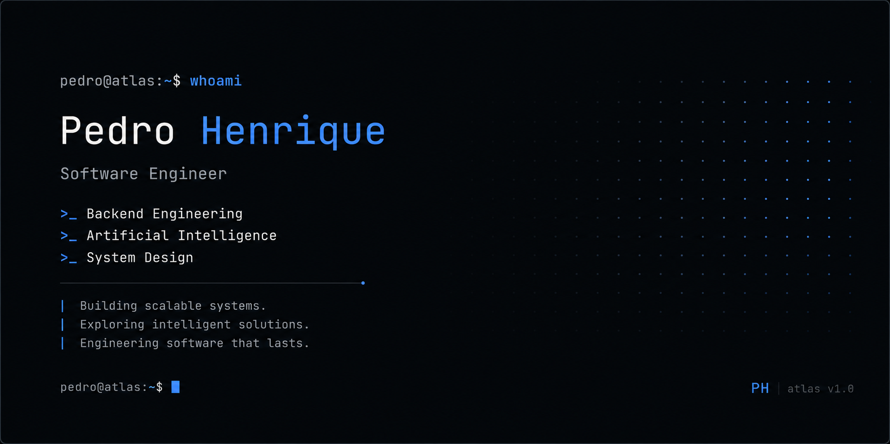

  

<h1 align="center">Hi, I'm Pedro Henrique 👋</h1>

  <strong>Backend Software Engineer · Java & Spring Boot · System Design · AI Integrations</strong> 
  Based in Brazil 🇧🇷 · Open to international remote opportunities

  
  
  

---

### `pedro@github:~$ whoami`

I'm a **Backend Software Engineer with 5 years of experience**, focused on **Java, Spring Boot, APIs, integrations, and software architecture**.

I enjoy translating complex business rules into reliable, maintainable systems. My recent work explores **AI-assisted applications**, modular design, security, and transactional consistency.

**→ [Visit my portfolio](https://phsouzaro.github.io/portfolio/)** for a guided overview of my projects and engineering approach.

### `pedro@github:~$ ls ./featured-projects`

<table>
<tr>
<td width="50%" valign="top">

#### ✈️ [Atlas Flight Booking Service](https://github.com/Phsouzaro/atlas-flight-booking-service)

**Java Backend · AI Engineering · Software Architecture**

A flight booking platform with an AI assistant for searching flights and preparing bookings, cancellations, and rebookings. Sensitive operations require **explicit user confirmation** and server-side validation.

**Highlights:** Spring Modulith, Spring AI, RAG, pgvector, idempotency, concurrency control, JWT, Testcontainers, CI/CD.

**Stack:** `Java 21` `Spring Boot` `Angular` `PostgreSQL` `Docker`

**[▶ Live browser demo](https://phsouzaro.github.io/atlas-flight-booking-service/)** · **[Source code](https://github.com/Phsouzaro/atlas-flight-booking-service)**

*Demo note: the publicly hosted version uses a simulated backend and scripted assistant. The full application uses Spring Boot and OpenAI.*

</td>
<td width="50%" valign="top">

#### 🏋️ [Overload](https://github.com/Phsouzaro/overload_app)

**Product Engineering · Mobile Development**

A workout tracking application with training sessions, exercise history, personal records, progress analytics, and local data persistence.

**Highlights:** Workout management, PR detection, analytics, data export, and a layered app structure.

**Stack:** `Flutter` `Dart` `Riverpod` `SQLite`

**[Source code](https://github.com/Phsouzaro/overload_app)**

</td>
</tr>
<tr>
<td width="50%" valign="top">

#### 🏛️ [Software Architecture Notes](https://github.com/Phsouzaro/mba-arquitetura-fullcycle)

**Architecture · System Design · Continuous Learning**

Structured notes and technical studies on solution architecture, domain understanding, trade-offs, and architectural decisions.

**[Explore notes](https://github.com/Phsouzaro/mba-arquitetura-fullcycle)**

</td>
<td width="50%" valign="top">

#### 🌐 [Personal Portfolio](https://github.com/Phsouzaro/portfolio)

**Web Engineering · Personal Site**

My bilingual, terminal-inspired engineering portfolio, built with Angular and designed to showcase practical work.

**Stack:** `Angular` `TypeScript` `CSS`

**[▶ Portfolio website](https://phsouzaro.github.io/portfolio/)** · **[Source code](https://github.com/Phsouzaro/portfolio)**

</td>
</tr>
</table>

### `pedro@github:~$ cat ./toolkit`

| Area | Technologies and practices |
| --- | --- |
| **Backend** | Java, Spring Boot, Spring Security, REST APIs, JPA / Hibernate |
| **Architecture** | Modular Monoliths, Spring Modulith, System Design, ADRs |
| **Data & Integration** | PostgreSQL, MySQL, Apache Camel, Flyway |
| **AI Engineering** | Spring AI, LLM Tool Calling, RAG, pgvector |
| **Delivery & Quality** | Docker, GitHub Actions, Testcontainers, Integration Testing, Observability |

### `pedro@github:~$ cat ./contact`

- 🌐 **Portfolio:** [phsouzaro.github.io/portfolio](https://phsouzaro.github.io/portfolio/)
- 💼 **LinkedIn:** [Pedro Henrique Souza](https://www.linkedin.com/in/pedro-henrique-souza-6b257616b)
- ✉️ **Email:** [phsouzaro@gmail.com](mailto:phsouzaro@gmail.com)

---

Build thoughtfully. Ship reliably. Keep learning.

